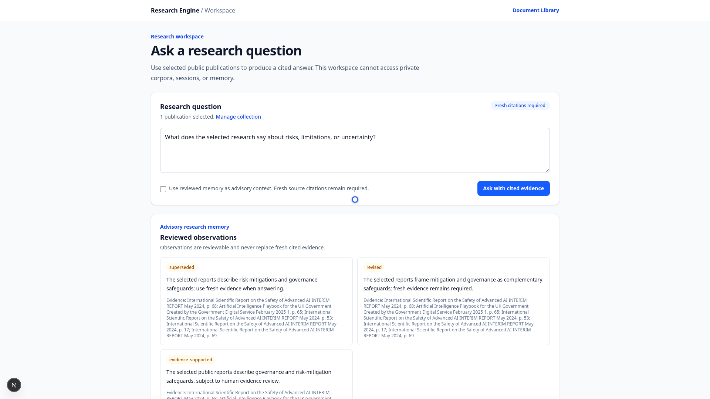
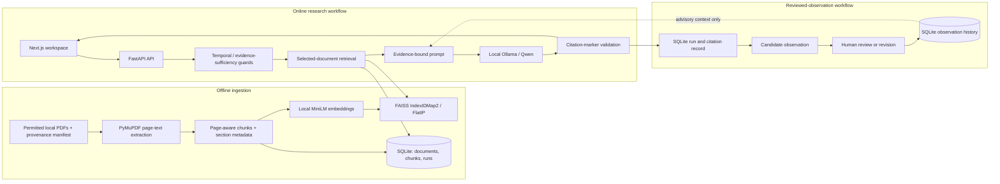
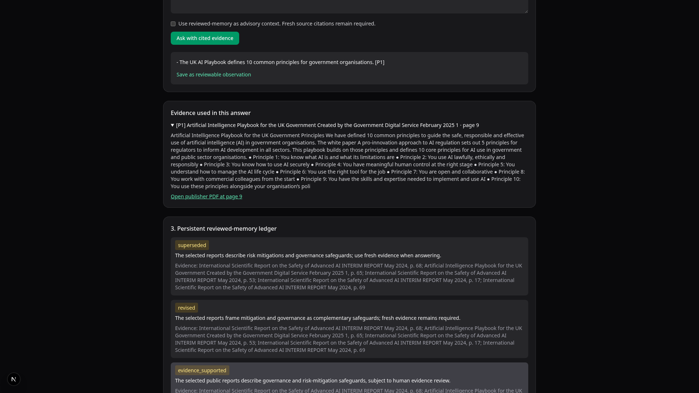
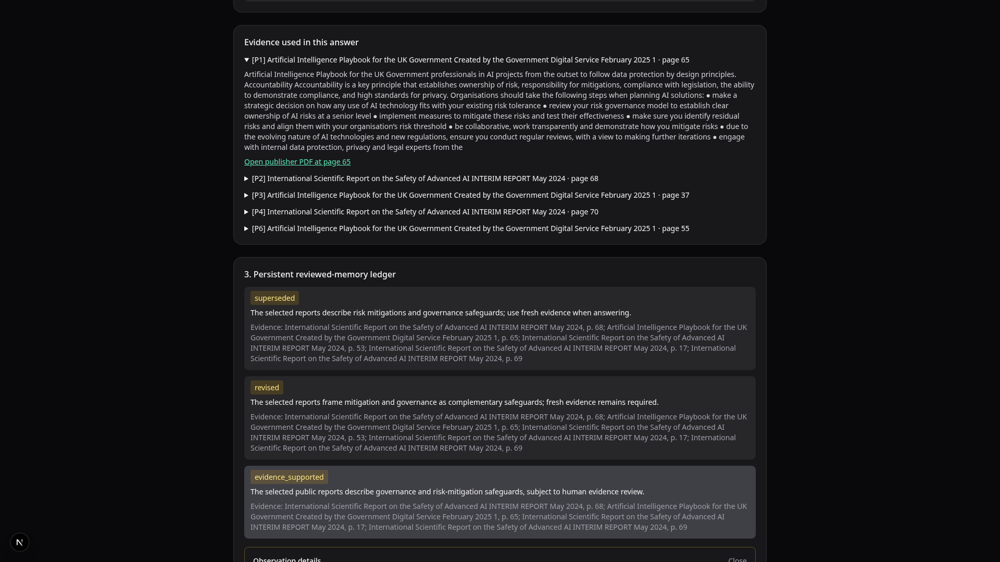

# Public Research Engine

A local, evidence-grounded research workspace for permitted PDF collections.
It answers questions from selected documents, shows page-level supporting
evidence, records reviewable observations, and abstains when the available
evidence is insufficient.



## Watch the demonstration

[Watch the 45-second local walkthrough](artifacts/research-engine-demo-ux-v3-short.mp4).
It visibly shows question entry, real local Qwen inference, continuous reading
through the answer, citation inspection, cross-document research, reviewed
memory, and an explicit abstention. The earlier walkthrough is retained as an
archived artifact. See the [event timeline](artifacts/research-engine-demo-ux-v2-events.jsonl)
and [edit log](artifacts/research-engine-demo-ux-v3-short-edits.json) for recorded
request and rendering checks.

## Key capabilities

- Ingest permitted text-based PDFs into a local document collection.
- Keep the document collection separate from the Research Workspace, so the
  question input is immediately available on opening the application.
- Select one or more documents in the Document Library for evidence-grounded Q&A.
- Return source title, page, section, and publisher link with each evidence
  item; reject answers whose citation markers do not match retrieved evidence.
- Detect unsupported or live-information requests and return an
  insufficient-evidence response rather than inventing an answer.
- Save cited findings as candidate observations, review them, and create
  immutable revisions. Reviewed memory is advisory only—fresh citations remain
  mandatory for every answer.

## System architecture



The ingestion path and the question-answering path share page-aware metadata,
but indexing is performed before questions are asked. The application keeps
document data, vector index, runs, and observation history local under the
runtime directory.

## Evidence and review interface

| Supporting evidence | Reviewed research memory |
| --- | --- |
|  |  |

## Technology stack

- **Interface:** Next.js and TypeScript
- **API and persistence:** FastAPI and SQLite
- **Retrieval:** PyMuPDF extraction, SentenceTransformers MiniLM, and FAISS
- **Local generation:** Ollama with a Qwen-class instruction model
- **Validation:** citation-marker checks, temporal-scope guards, abstention,
  and source-only release auditing

## Run locally

Requirements: Python 3.11+, Node.js 20+, a local Ollama-compatible service,
and a locally available MiniLM model. The public repository intentionally does
not contain publisher PDFs, extracted text, indexes, or model weights.

```bash
python -m venv .venv
.venv/bin/pip install -r backend/requirements.txt

# Add only PDFs you are permitted to process and record their provenance.
mkdir -p data/public-research-demo/pdfs
# Then update data/public-research-demo/manifest.json.

export OLLAMA_MODEL=qwen2.5:7b
export MINILM_PATH=/absolute/path/to/all-MiniLM-L6-v2
.venv/bin/python scripts/index_public_research_demo.py
.venv/bin/python -m uvicorn backend.main:app --host 127.0.0.1 --port 8003
```

In a second terminal:

```bash
cd frontend
npm ci
NEXT_PUBLIC_PUBLIC_RESEARCH_URL=http://127.0.0.1:8003 npm run dev
```

Open `http://127.0.0.1:3000`. Ensure your local Ollama service and chosen model
are available before submitting a question.

## Testing and validation

```bash
.venv/bin/python -m pytest backend/tests -q
cd frontend && npm run build
cd .. && bash scripts/audit-public-release.sh
```

The recorded walkthrough has a separate [verification report](artifacts/research-engine-demo-verification.md),
with real backend request IDs, citation checks, and public/private isolation
notes. The source video and highlight remain local demonstration artifacts;
neither substitutes for independent evaluation of a new document collection.

## Limitations, licence, and acknowledgments

- Local semantic retrieval can miss relevant pages in long reports. Inspect the
  cited source page and treat the result as research assistance.
- This is a local, single-user demonstration—not a multi-tenant or hosted
  service. Reviewed observations are not verified truth and never replace fresh
  evidence.
- The code is licensed under the [MIT License](LICENSE). Publisher documents,
  model weights, and third-party material are not redistributed; consult the
  [third-party notices](docs/THIRD_PARTY_NOTICES.md) and each source's licence
  before adding a collection.
